# ha-heating-card

[](https://www.home-assistant.io/integrations/marketplace/)
[](https://github.com/juju35/ha-heating-card/actions/workflows/hacs.yml)
[](https://github.com/juju35/ha-heating-card/actions/workflows/validate.yml)
[](https://github.com/juju35/ha-heating-card/actions/workflows/lint.yml)
[](https://github.com/juju35/ha-heating-card/releases/latest)
[](https://github.com/juju35/ha-heating-card/blob/main/LICENSE)
[](https://buymeacoffee.com/julienstep9)

Lovelace cards for the **heating** of your home in Home Assistant, zone by zone: **thermostats** (wall thermostats, electric radiators, radiator valves), **pilot wire radiators** (comfort, eco, frost protection, off, comfort −1 / −2) and their **weekly schedules**.

The cards work on top of the integrations you already use: any `climate` entity that heats (Netatmo, tado°, Zigbee2MQTT and ZHA radiator valves, Generic Thermostat, Heatzy…), any `select` entity offering pilot wire orders (Nodon, Legrand and other pilot wire modules through Zigbee2MQTT or ZHA, Heatzy…) or a `switch` relay, and Home Assistant's own `schedule` helpers. Zones are **found automatically** and grouped by area: you don't pick the entities one by one. Air conditioners, fans and purifiers are left to [ha-climate-air-card](https://github.com/juju35/ha-climate-air-card): this card only shows heating.

[](https://my.home-assistant.io/redirect/marketplace_repository/?owner=juju35&repository=ha-heating-card&category=plugin)

| Heating Card | Heating Mini Card |
|---|---|
| 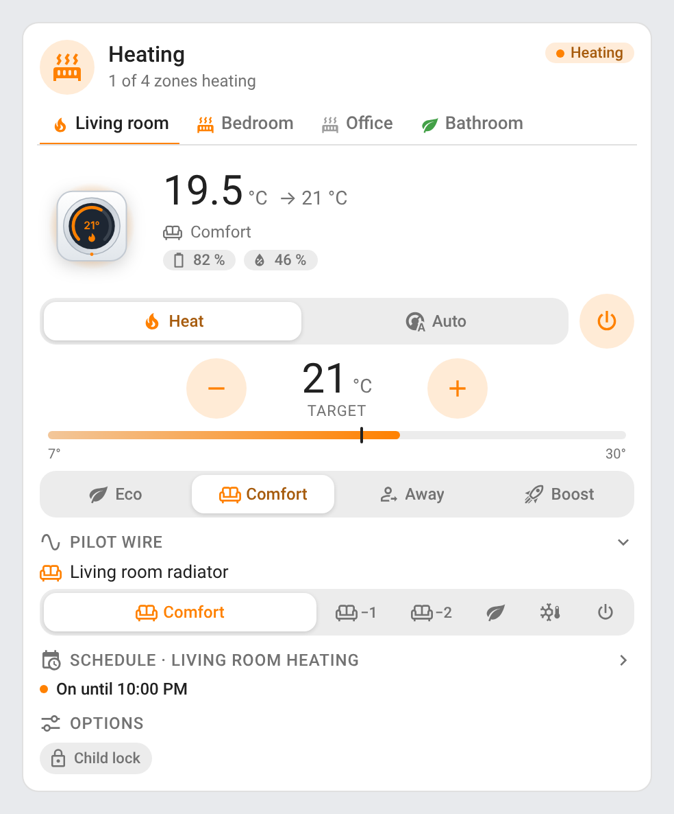 | 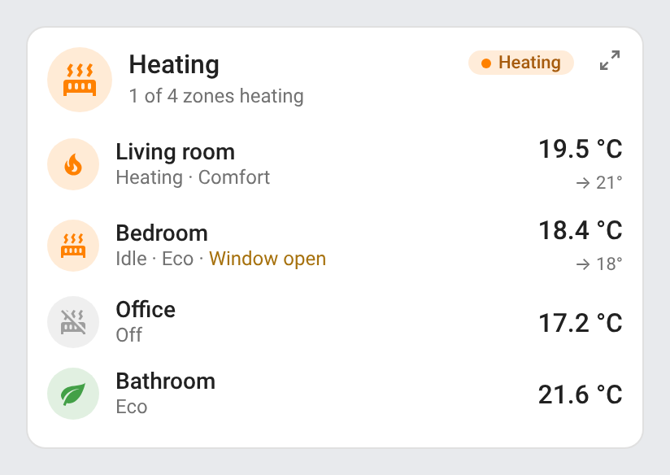<br> |

## Features

- Two cards: a full **Heating Card** (`custom:heating-card`) and a compact **Heating Mini Card** (`custom:heating-mini-card`)
- Several **zones**, as text tabs under the header (the selected one underlined in its color, a flickering flame on a zone that heats); found automatically by area or set with `zones`
- **Thermostat** (from the thermostat card of [ha-climate-air-card](https://github.com/juju35/ha-climate-air-card)): animated illustration (round wall thermostat, column radiator or radiator valve, picked from the device model and name), room temperature and target, heating modes (*Heat*, *Auto*) and a power button
- **Target**: − / + buttons sent once the taps stop, a scale from the entity's minimum to its maximum with the room temperature as a tick, keyboard spin button (arrows, Page Up / Down, Home / End), buttons off at the limits, a low / high range for thermostats that set one
- **What it does** from `hvac_action` (*Heating*, *Preheating*, *Idle*, *Off*, *Defrosting*): the flame flickers and warm air rises only while it really heats; **Boost** doubles the animation speed, in red
- **Presets** as segmented buttons (*Comfort*, *Eco*, *Away*, *Boost*, *Frost protection*, *Comfort −1 / −2*…), a dropdown when there are more than seven; a tap on the selected one goes back to manual
- The fan mode, swing mode and target humidity of the thermostats that have them, as dropdowns
- **Pilot wire** radiators: one row of orders per radiator (`select` or `switch` relay), each order in its color (*−1* / *−2* stay on the icon-only buttons of comfort −1 / −2); the radiator glows on comfort and breathes on eco
- **Weekly schedule**: the week of a `schedule` helper as seven rows of time slots, today highlighted with a pulsing "now" line, and its state (*On until 22:00*)
- Valve opening, battery, humidity, outdoor temperature and power chips; *Window open* and *Low battery* (15 % or less) alerts; the thermostat's other switches (child lock, window detection…) as option toggles
- The header icon and status pill follow the whole home: heating, idle, off or unavailable; the subtitle counts the zones heating
- Mini card: the overview of the zones, one row each, a click unfolding the full card on that zone; on one zone, the compact thermostat with − / + and power. Detail button at the top right; a click anywhere outside the card brings the compact view back
- Collapsible sections (the schedule folded by default), folded back on a click elsewhere
- Sections view: the full card takes 12 columns and at least 6, the mini card 6; narrow widths get their own layout (see [Screenshots](#screenshots))
- Click a chip, the illustration or the schedule state to open its Home Assistant history (more-info dialog)
- Visual editor in the dashboard UI for both cards, zones included (no YAML needed)
- Light and dark mode, English, French, German, Spanish, Serbian (Cyrillic and Latin), Italian, Dutch, European Portuguese, Polish, Romanian, Danish, Swedish, Bulgarian, Russian, Ukrainian, Hungarian, Slovak, Czech, Slovenian, Latvian and Greek
- Single file, no external dependency, the illustrations and icons are embedded

## Supported integrations

| Entities | Integrations (examples) | What the cards show |
|---|---|---|
| `climate` that heats and cannot cool, dry or only blow | [Netatmo](https://www.home-assistant.io/integrations/netatmo/), [tado°](https://www.home-assistant.io/integrations/tado/), [Zigbee2MQTT](https://www.zigbee2mqtt.io/) and [ZHA](https://www.home-assistant.io/integrations/zha/) radiator valves and thermostats, [Generic Thermostat](https://www.home-assistant.io/integrations/generic_thermostat/), [Heatzy](https://github.com/Cyr-ius/hass-heatzy) | Thermostat: target, modes, presets, `hvac_action`, and the valve, window and battery sensors of its device |
| `select` offering pilot wire orders | [Zigbee2MQTT](https://www.zigbee2mqtt.io/) / [ZHA](https://www.home-assistant.io/integrations/zha/) pilot wire modules (Nodon SIN-4-FP-21, Legrand cable outlet…), any select whose options are pilot wire orders | Pilot wire orders, comfort / comfort −1 / comfort −2 / eco / frost protection / off |
| `switch` | A relay on the pilot wire (with or without a diode) | The two orders set with `switch_on` / `switch_off` |
| `schedule` | Home Assistant's [Schedule](https://www.home-assistant.io/integrations/schedule/) helper | Weekly plan and current state |
| `sensor` | Any temperature and humidity sensor | Room temperature and humidity of a zone without thermostat |

Pilot wire orders are recognized whatever the integration spells them: `comfort`, `comfort_-1`, `comfort-2`, `eco`, `frost_protection`, `off`, and French names (`Confort`, `Hors-gel`, `Arrêt`…). Air conditioners and heat pumps that can cool are left out (see [ha-climate-air-card](https://github.com/juju35/ha-climate-air-card)).

## Prerequisites

Home Assistant 2024.8 or later. The week of every schedule is read with the `schedule.get_schedule` action (Home Assistant 2025.1 or later); on earlier versions, only the schedules created in the UI are drawn.

## Installation

### Via the Marketplace (recommended)

Click the button below to add the repository directly:

[](https://my.home-assistant.io/redirect/marketplace_repository/?owner=juju35&repository=ha-heating-card&category=plugin)

Then click **Install**, and reload your browser when the Marketplace asks you to.

Or manually:

1. Open **Settings → Marketplace → Add from link** (top right; this needs a GitHub account connected)
2. Add `https://github.com/juju35/ha-heating-card` — Type: **Dashboard**
3. Open **Heating Card** and click **Install**
4. Check that **Settings → Dashboards → ⋮ → Resources** lists `/local/community/ha-heating-card/heating-card.js`
5. Clear your browser cache and refresh

### Manual

1. Download `heating-card.js` and the `heating-card.i18n.*.js` translation files from the [latest release](https://github.com/juju35/ha-heating-card/releases/latest)
2. Copy them all to `/config/www/` (without the translation files, the cards show in English)
3. Go to **Settings → Dashboards → ⋮ → Resources** → Add resource:
   - URL: `/local/heating-card.js`
   - Type: **JavaScript Module**
4. Clear your browser cache and refresh

## Configuration

### Card types

| Card | Type |
|---|---|
| Heating Card | `custom:heating-card` |
| Heating Mini Card | `custom:heating-mini-card` |

### Visual editor

Edit a dashboard, click **Add card** and search for **Heating Card** or **Heating Mini Card**. Without zones, every heating thermostat and pilot wire radiator is found and grouped by area. Open **Add a zone** to set your own: name, thermostat, pilot wire radiators, room temperature and humidity sensors, schedule, window sensor, illustration and, for a relay, the orders it sends. The preview updates live, and options left at their default are kept out of the generated YAML.

### Minimal

```yaml
type: custom:heating-card
```

```yaml
type: custom:heating-mini-card
```

One thermostat:

```yaml
type: custom:heating-card
entity: climate.living_room
schedule: schedule.living_room_heating
```

### Coming from ha-climate-air-card

The thermostat card of [ha-climate-air-card](https://github.com/juju35/ha-climate-air-card) lives on here: replace `custom:climate-air-thermostat-card` with `custom:heating-card` and `custom:climate-air-thermostat-mini-card` with `custom:heating-mini-card`. Its options keep their names and meaning: `entity`, `name`, `icon`, `illustration`, `entities`, `show_title`, `show_subtitle`, `show_controls`, `show_sensors`, `show_alerts`, `zoom` and `language`.

```yaml
type: custom:heating-card
entity: climate.bedroom_radiator
illustration: valve
```

### Full options

```yaml
type: custom:heating-card
title: Heating
zones:
  - name: Living room
    entity: climate.living_room_thermostat
    pilot_wire:
      - select.living_room_radiator_pilot_wire_mode
    schedule: schedule.living_room_heating
  - name: Bedroom
    entity: climate.bedroom_radiator_valve
    illustration: valve
    window: binary_sensor.bedroom_window
  - name: Bathroom
    pilot_wire: select.towel_radiator_mode
    temperature: sensor.bathroom_temperature
    humidity: sensor.bathroom_humidity
  - name: Hallway
    pilot_wire: switch.hallway_radiator_relay
    switch_on: eco
    switch_off: comfort
show_title: true
show_subtitle: true
show_controls: true
show_sensors: true
show_alerts: true
show_pilot_wire: true
show_schedule: true
collapsed:
  - schedule
language: en
```

```yaml
type: custom:heating-mini-card
zoom: true
```

### Options reference

| Option | Card | Default | Description |
|---|---|---|---|
| `zones` | Both | Auto | The zones (see [Zone options](#zone-options)); a zone may also be a bare entity id: a thermostat, or a pilot wire `select` / `switch`. Without `zones`, `entity` or `pilot_wire`, every zone is found by area |
| `entity`, `pilot_wire`, … | Both | — | One zone set at the top level: every [zone option](#zone-options) works there too |
| `title` | Both | *Heating*, or the zone name with one zone | Card title (`name` is accepted too) |
| `show_title` | Both | `true` | Show the title in the header (e.g. `false` under a section heading of your own) |
| `show_subtitle` | Both | `true` | Show the subtitle (zones heating, or the zone and its preset) |
| `show_controls` | Both | `true` | Modes, power, target, presets and option toggles |
| `show_sensors` | Both | `true` | Valve, battery, humidity, outdoor temperature and power chips |
| `show_alerts` | Both | `true` | *Window open* and *Low battery* alerts |
| `show_pilot_wire` | Full | `true` | Pilot wire section |
| `show_schedule` | Full | `true` | Weekly schedule section |
| `collapsed` | Full | `[schedule]` | Sections folded at first: `pilot_wire`, `schedule` |
| `zoom` | Mini | `true` | Detail button at the top right that unfolds the full card (a click elsewhere folds it back) |
| `language` | Both | Auto | Force language: `en`, `fr`, `de`, `es`, `sr`, `sr-Latn`, `it`, `nl`, `pt`, `pl`, `ro`, `da`, `sv`, `bg`, `ru`, `uk`, `hu`, `sk`, `cs`, `sl`, `lv` or `el` (auto-detects from HA settings; `pt-BR` gets European Portuguese) |

### Zone options

| Option | Default | Description |
|---|---|---|
| `name` | Area or device name | Zone name (tab and row) |
| `entity` | — | The thermostat (`climate`) |
| `pilot_wire` | — | Pilot wire radiators: one entity or a list (`select` or `switch`) |
| `temperature` / `humidity` | The thermostat's, or the area's sensors (automatic zones) | Room temperature and humidity sensors |
| `schedule` | The area's schedule helper (automatic zones) | A `schedule` helper drawn as the zone's week |
| `window` | The device's open-window sensor | `binary_sensor` raising the *Window open* alert |
| `illustration` | `auto` | `dial` (round wall thermostat), `radiator` or `valve` (radiator valve); `auto` picks one from the device model and name, `radiator` for a pilot wire zone |
| `icon` | — | An `mdi:` icon instead of the illustration |
| `switch_on` / `switch_off` | `comfort` / `off` | The orders a `switch` relay sends when on and off: `comfort`, `comfort_1`, `comfort_2`, `eco`, `frost`, `off` (e.g. `eco` / `comfort` for a relay with a diode) |
| `entities` | Auto | Override the sensors found on the thermostat's device: `indoor_temp`, `outdoor_temp`, `humidity`, `power`, `valve`, `window`, `battery` |

## Screenshots

All screenshots are rendered from the cards' own code with mock data (`npm run screenshots`), in the light and dark themes.

### Animations

The wall thermostat heats: its flame flickers, warm air rises above it, its halo glows and its LED blinks; the arc shows where the target sits between the minimum and the maximum.

| Light | Dark |
|---|---|
|  | 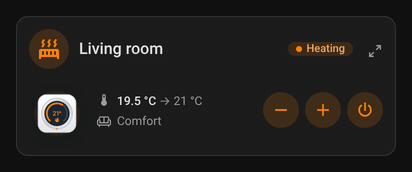 |

The same thermostat drawn as a column radiator (`illustration: radiator`): its columns glow from the bottom up and heat rises.

| Light | Dark |
|---|---|
| 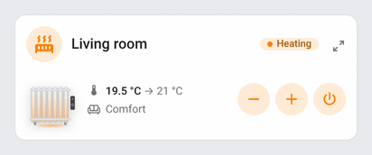 | 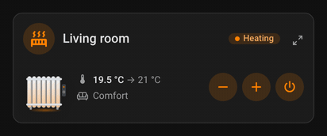 |

A radiator valve open at 45 %: its radiator glows and heat rises.

| Light | Dark |
|---|---|
| 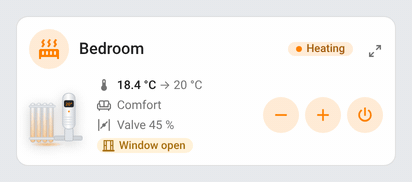 | 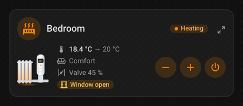 |

Boost: the flame and the heat go twice as fast, in red.

| Light | Dark |
|---|---|
| 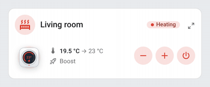 | 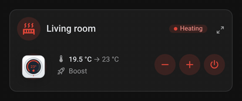 |

A pilot wire radiator on comfort glows and gives off heat.

| Light | Dark |
|---|---|
| 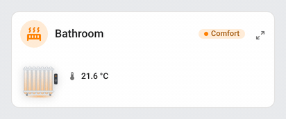 | 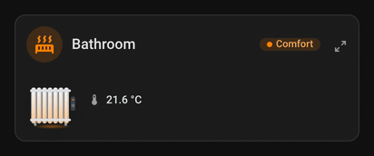 |

On eco, it breathes slowly in green.

| Light | Dark |
|---|---|
| 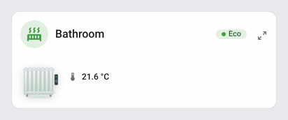 | 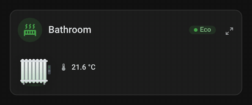 |

The overview: the flame of each zone that heats flickers, and the heat waves of the header radiator rise.

| Light | Dark |
|---|---|
| 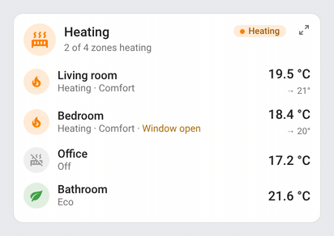 | 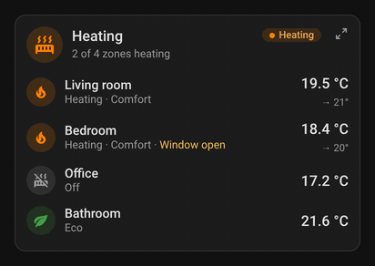 |

### Heating Card

Every zone found on its own: the living room's wall thermostat heating, its presets, its pilot wire radiator and its schedule (folded).

| Light | Dark |
|---|---|
|  | 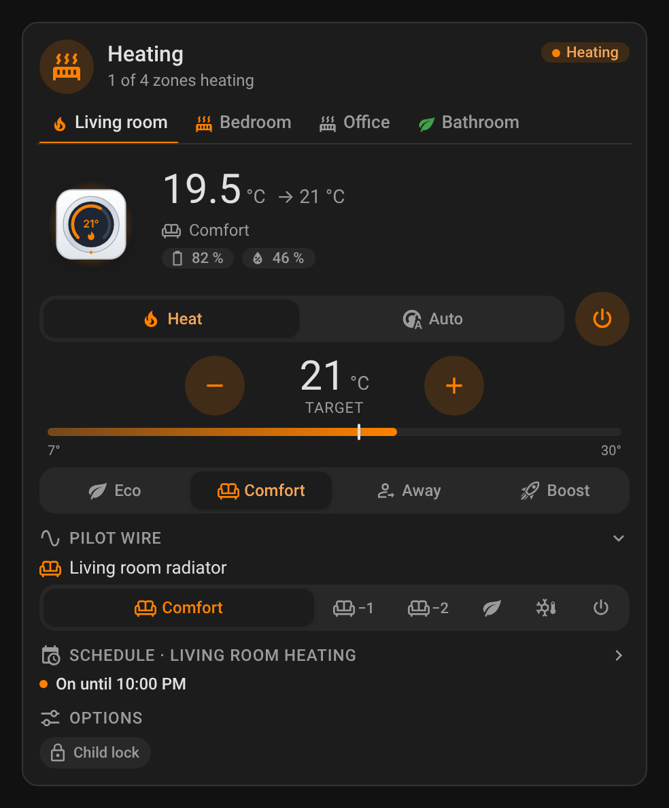 |

The weekly schedule unfolded, today highlighted with its "now" line.

| Light | Dark |
|---|---|
| 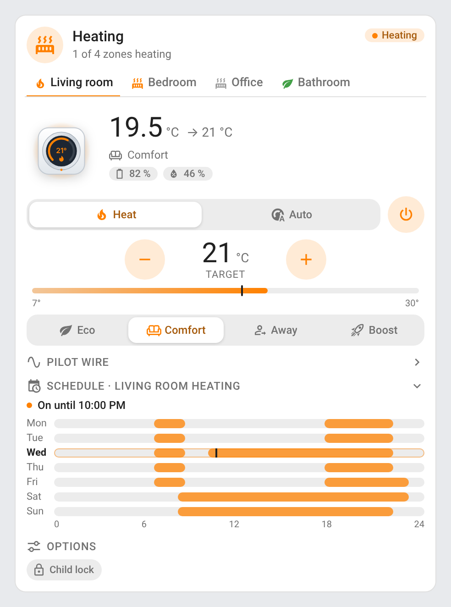 | 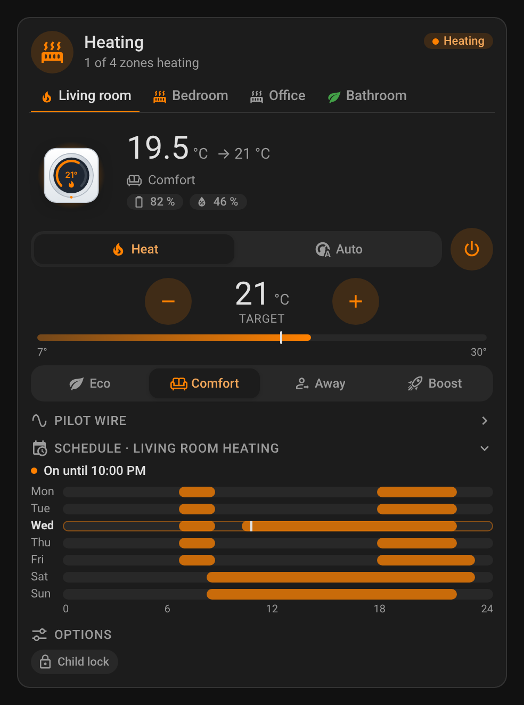 |

The bedroom's radiator valve: idle, window open, battery and valve chips; with heat as its only mode, the power button sits next to the target.

| Light | Dark |
|---|---|
|  | 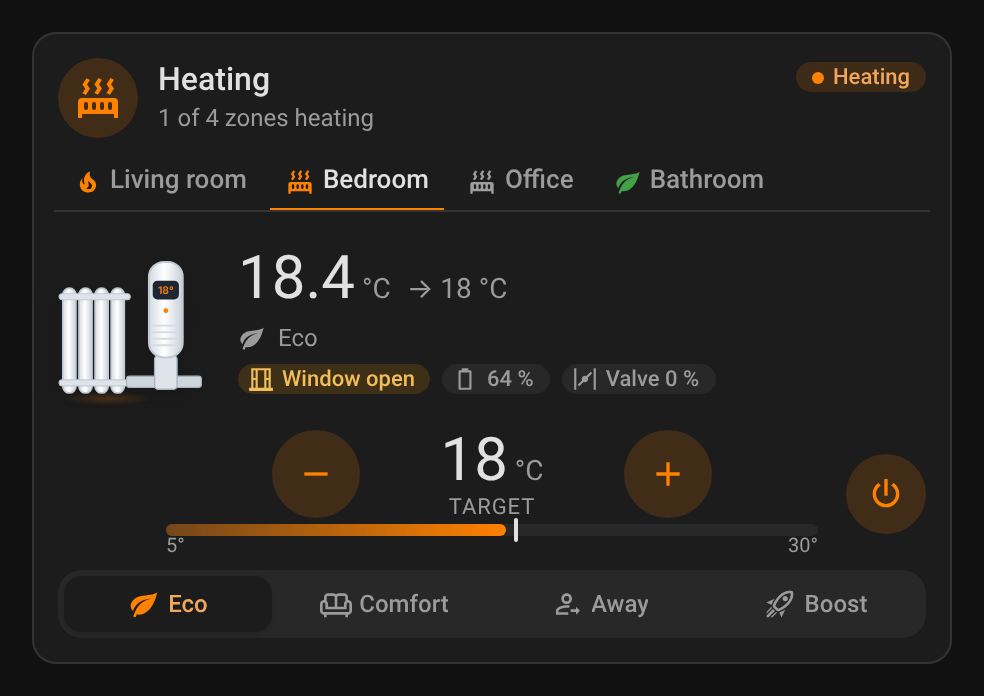 |

The bathroom's towel radiator on pilot wire, with the room's temperature and humidity.

| Light | Dark |
|---|---|
| 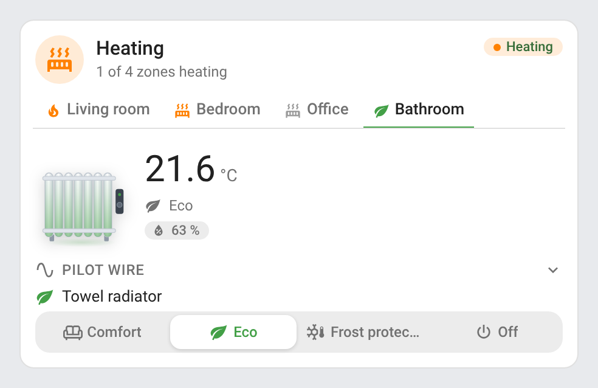 | 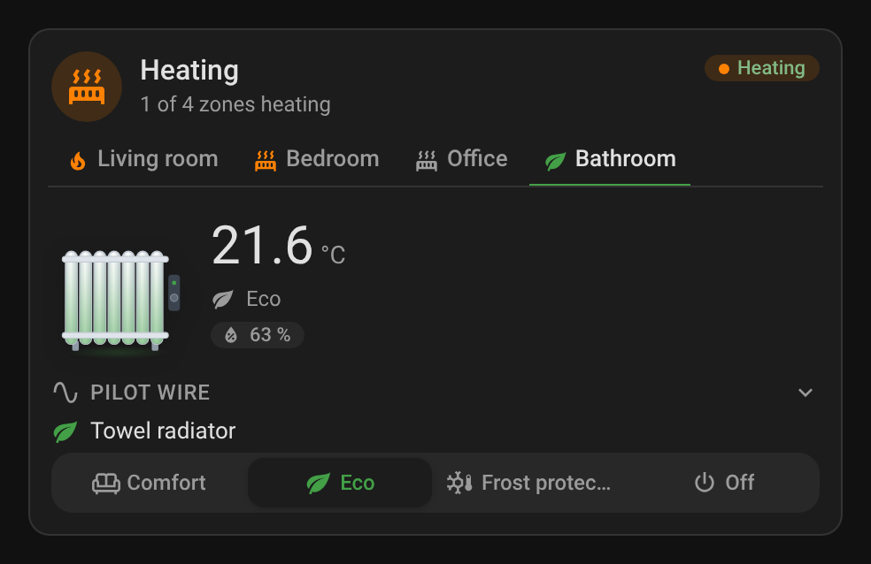 |

### Heating Mini Card

The overview of the zones (state, preset, alert, room temperature and target), and the mini card on one thermostat.

| Light | Dark |
|---|---|
|  | 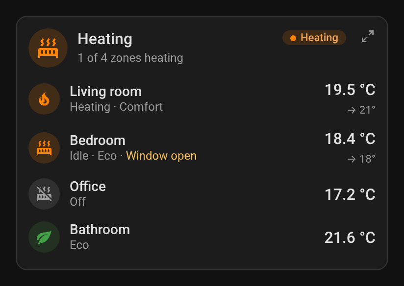 |
| 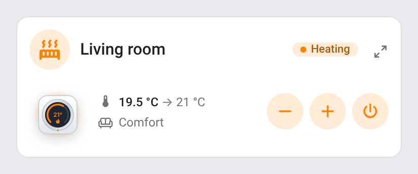 |  |

A click on a row unfolds the full card on that zone (here the bedroom).

| Light | Dark |
|---|---|
| 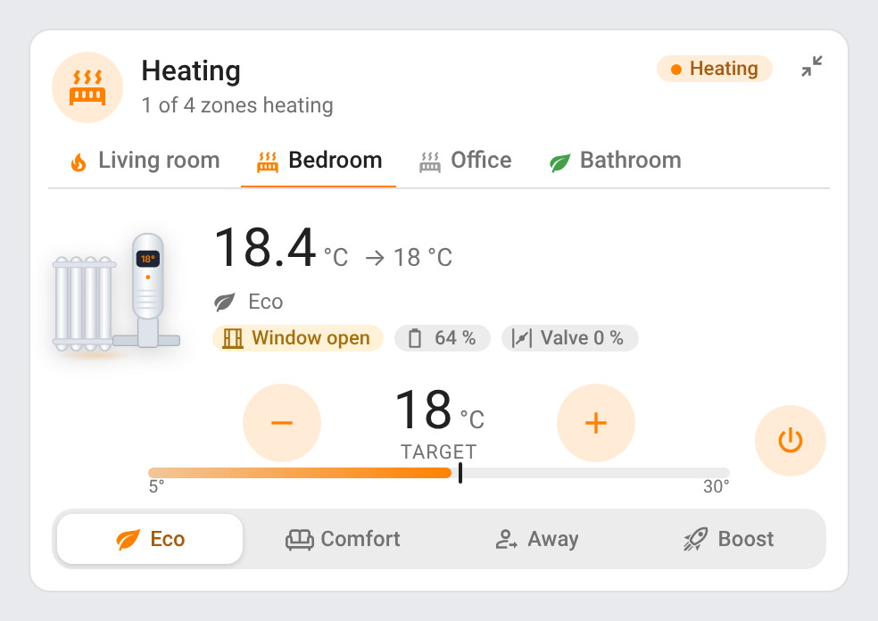 | 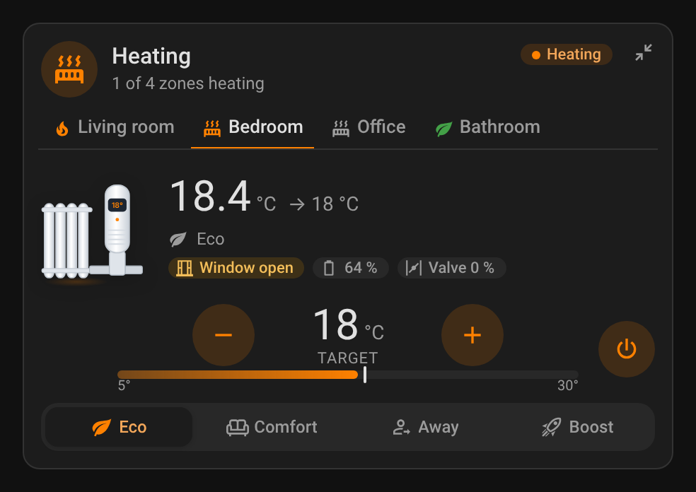 |

### Narrow cards

The full card at 6 columns of a narrow Sections view (238 px): the tabs scroll, the segments not selected keep their icon only. The mini card at 6 columns of a phone (170 px): the status pill keeps its dot, the rows drop their icon.

| Full card | Mini card |
|---|---|
| 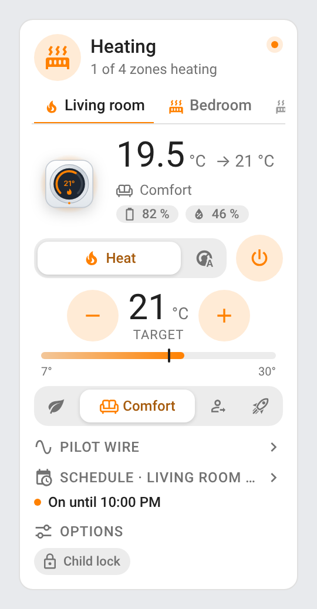 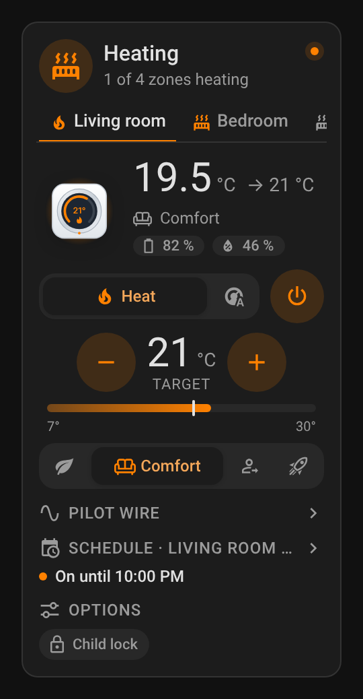 | 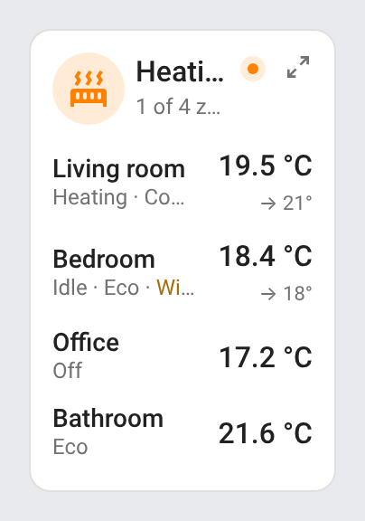 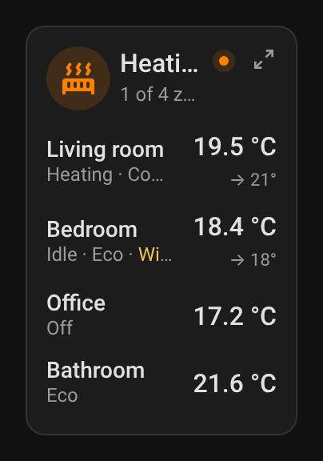 |

## How it works

### Zones

Without `zones`, the cards take every heating thermostat (a `climate` entity with a heating mode and no cooling, drying or fan-only mode) and every pilot wire `select` of the instance (except the selects of an air conditioner's or a fan's device), hidden entities left out, and group them by area, in the order of the area registry: an area's first thermostat, all its pilot wire radiators and its schedule helper make one zone; a zone without thermostat takes the area's temperature and humidity sensors. A second thermostat in an area (named after its device), and entities without an area, get a zone of their own.

### Thermostats

The sensors of a thermostat's device are found through the entity registry, by translation key, entity id (English, French, German and Spanish) or device class: room and outdoor temperature, humidity, power, valve opening, open-window detection and battery. A thermostat heats when its `hvac_action` says so (`heating`, `preheating`), or, without `hvac_action`, while its valve is open. The power button turns the thermostat off with `climate.set_hvac_mode` (`climate.turn_off` when it has no off mode) and back on with `set_hvac_mode` in the mode it had before the card turned it off (else *Heat*, *Auto*, then *Heat/Cool*), which every thermostat takes, unlike `climate.turn_on`. A target change is shown at once, sent 0.9 s after the last tap, and kept on screen until the entity reports it (10 s at most); a target still waiting when the card is removed is sent right away.

### Pilot wire

A `select` is a pilot wire radiator when at least three of its options are pilot wire orders. A button calls `select.select_option` with the select's own spelling of the order. A `switch` relay offers the two orders of `switch_on` and `switch_off` and calls `switch.turn_on` / `turn_off`.

### Schedules

The week is read once per state change of the schedule with `schedule.get_schedule`, else with the list of the schedule helpers created in the UI (matched by unique id or name), and shared by every card of the page. The "now" line moves every minute.

## Development

```bash
npm install
npm run build        # bundles src/heating-card.js into dist/heating-card.js and its dist/heating-card.i18n.<lang>.js translations
npm run check        # builds and checks the card (run in CI)
npm test             # unit tests (and, with Playwright and Chromium installed, the layout tests)
npm run screenshots  # renders the cards (and one GIF per animated state, needs ffmpeg) with mock data into screenshots/
```

`dist/` is not committed: `npm run build` creates it locally, CI builds it on every push, and the release workflow attaches the built files to the release, which is where the Marketplace installs it from. Screenshots are compared pixel by pixel with the committed ones, exactly: the **Screenshots** workflow commits them on the pull request's branch only when they change.

### Releasing

1. Bump `version` in `package.json` (and `package-lock.json`, with `npm install`)
2. Add a `## <version>` section at the top of [CHANGELOG.md](https://github.com/juju35/ha-heating-card/blob/main/CHANGELOG.md)
3. Push to `main`: the **Release** workflow builds the card, creates the tag and the GitHub release with the changelog section as notes, and attaches `heating-card.js` and its translation files

## Translations

The cards auto-detect the language from your Home Assistant settings. Currently supported:

| Language | Code |
|---|---|
| English | `en` |
| Français | `fr` |
| Deutsch | `de` |
| Español | `es` |
| Српски | `sr` |
| Srpski (latinica) | `sr-Latn` |
| Italiano | `it` |
| Nederlands | `nl` |
| Português (European; also used for `pt-BR`) | `pt` |
| Polski | `pl` |
| Română | `ro` |
| Dansk | `da` |
| Svenska | `sv` |
| Български | `bg` |
| Русский | `ru` |
| Українська | `uk` |
| Magyar | `hu` |
| Slovenčina | `sk` |
| Čeština | `cs` |
| Slovenščina | `sl` |
| Latviešu | `lv` |
| Ελληνικά | `el` |

Contributions for additional languages are welcome!

## Credits

The thermostat illustrations and the thermostat logic come from [ha-climate-air-card](https://github.com/juju35/ha-climate-air-card). Icons from [Material Design Icons](https://pictogrammers.com/library/mdi/) (Apache License 2.0). Netatmo, tado°, Heatzy, Nodon and Legrand are trademarks of their respective owners; this project is not affiliated with them.

## License

[MIT](https://github.com/juju35/ha-heating-card/blob/main/LICENSE)

## Support

If you find this project useful, you can support its development:

<a href="https://buymeacoffee.com/julienstep9"></a>
